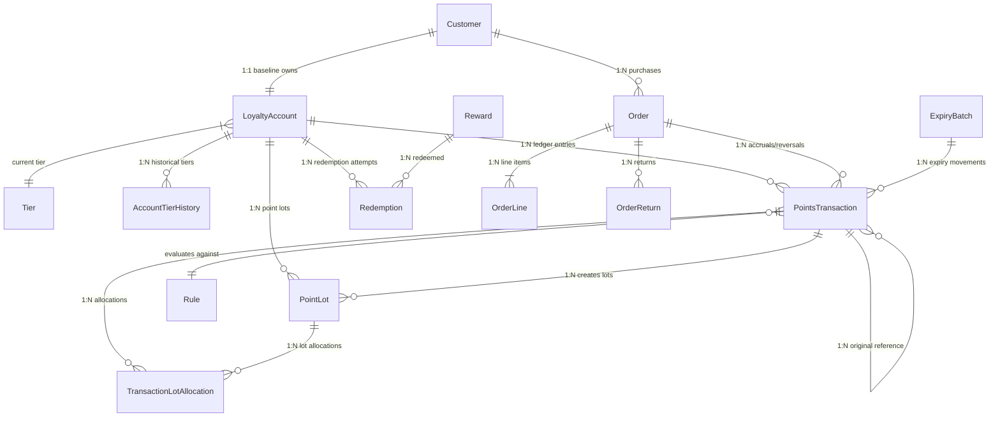

# Entity Relationships & Cardinality

## 1. Entity-Relationship Overview
The relational data model consists of 10 core business entities, 5 supporting lifecycle tables, and 1 isolated ground truth evaluation table.

---

## 2. Cardinality & Foreign Key Specification

| Parent Entity | Child Entity | Cardinality | Join Keys | On Delete Behavior | Business Context |
| :--- | :--- | :--- | :--- | :--- | :--- |
| `Customer` | `LoyaltyAccount` | 1:1 | `Customer.customer_id = LoyaltyAccount.customer_id` | RESTRICT | Each synthetic customer has exactly one baseline loyalty account. |
| `Tier` | `LoyaltyAccount` | 1:N | `Tier.tier_id = LoyaltyAccount.current_tier_id` | RESTRICT | Many accounts hold the same tier. |
| `LoyaltyAccount` | `AccountTierHistory` | 1:N | `LoyaltyAccount.account_id = AccountTierHistory.account_id` | CASCADE | Audit log of tier upgrades/downgrades over time. |
| `Customer` | `Order` | 1:N | `Customer.customer_id = Order.customer_id` | RESTRICT | A customer can place multiple orders. |
| `Order` | `OrderLine` | 1:N | `Order.order_id = OrderLine.order_id` | CASCADE | An order must contain one or more order lines. |
| `Order` | `OrderReturn` | 1:N | `Order.order_id = OrderReturn.order_id` | RESTRICT | An order can be subject to multiple partial returns. |
| `LoyaltyAccount` | `PointsTransaction` | 1:N | `LoyaltyAccount.account_id = PointsTransaction.account_id`| RESTRICT | Every transaction alters one loyalty account balance. |
| `PointsTransaction`| `PointsTransaction`| 1:N (Optional) | `original_transaction_id = transaction_id` | RESTRICT | A reversal references its original accrual. |
| `PointsTransaction`| `PointLot` | 1:N | `PointsTransaction.transaction_id = PointLot.source_transaction_id`| RESTRICT | An accrual transaction spawns an identifiable point lot. |
| `PointLot` | `TransactionLotAllocation`| 1:N | `PointLot.lot_id = TransactionLotAllocation.lot_id` | RESTRICT | Tracks points consumed by redemption, reversal, or expiry. |
| `PointsTransaction`| `TransactionLotAllocation`| 1:N | `PointsTransaction.transaction_id = TransactionLotAllocation.transaction_id`| RESTRICT | Associates debit transaction to lot deductions. |
| `Reward` | `Redemption` | 1:N | `Reward.reward_id = Redemption.reward_id` | RESTRICT | Rewards can be redeemed by multiple customers. |
| `LoyaltyAccount` | `Redemption` | 1:N | `LoyaltyAccount.account_id = Redemption.account_id` | RESTRICT | A customer can make multiple redemption attempts. |
| `ExpiryBatch` | `PointsTransaction` | 1:N (Optional) | `ExpiryBatch.expiry_batch_id = PointsTransaction.source_id`| RESTRICT | An expiry batch can create multiple expiry transactions. |
